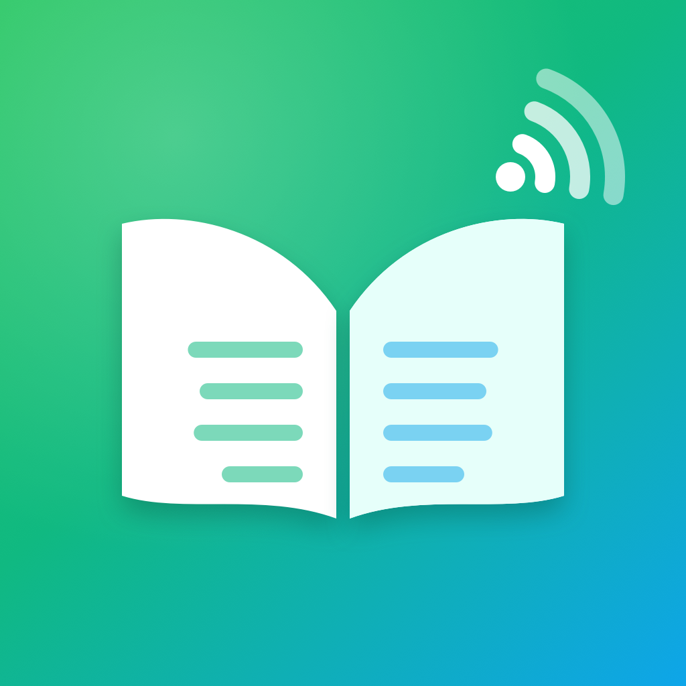
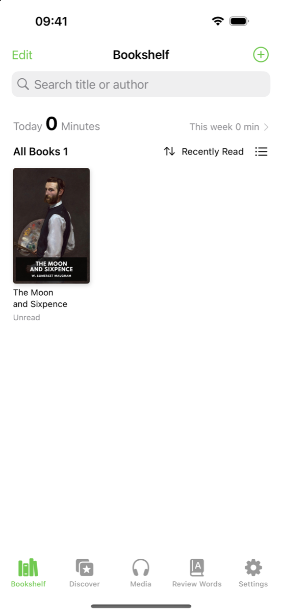
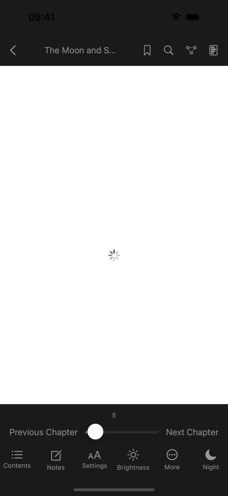
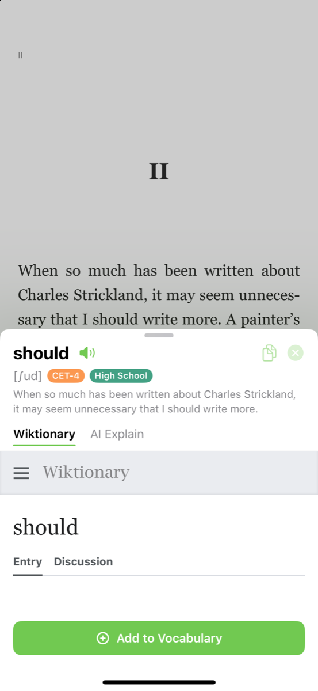
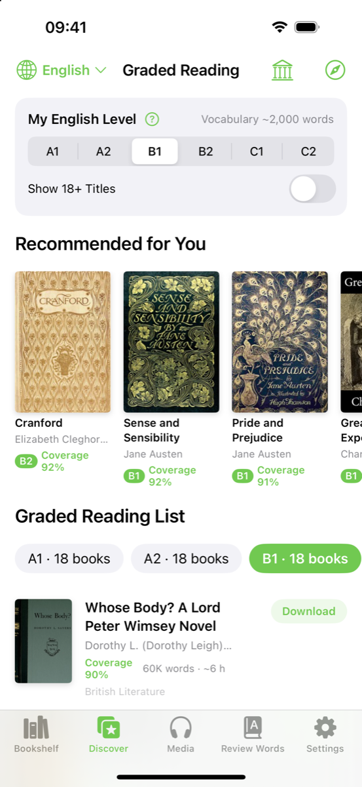
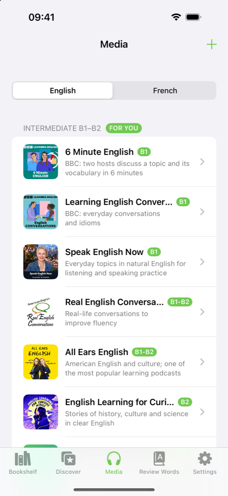
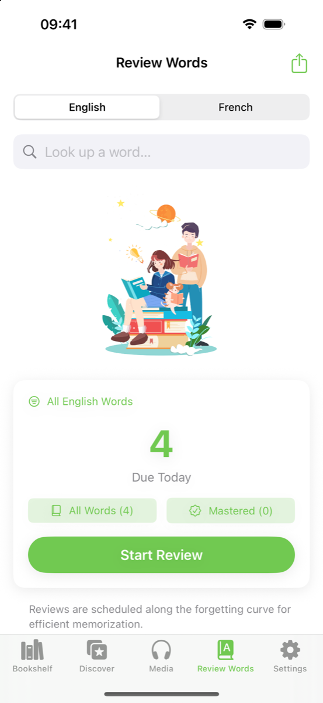
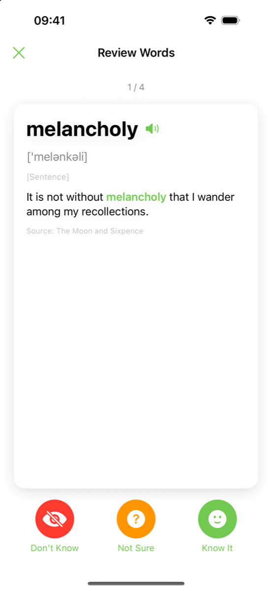
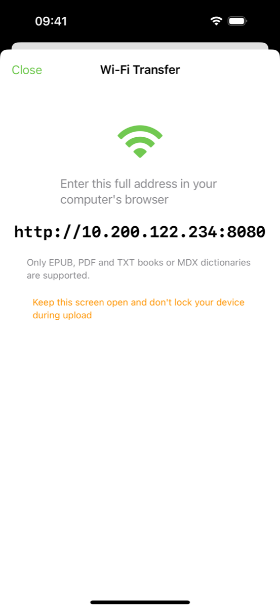
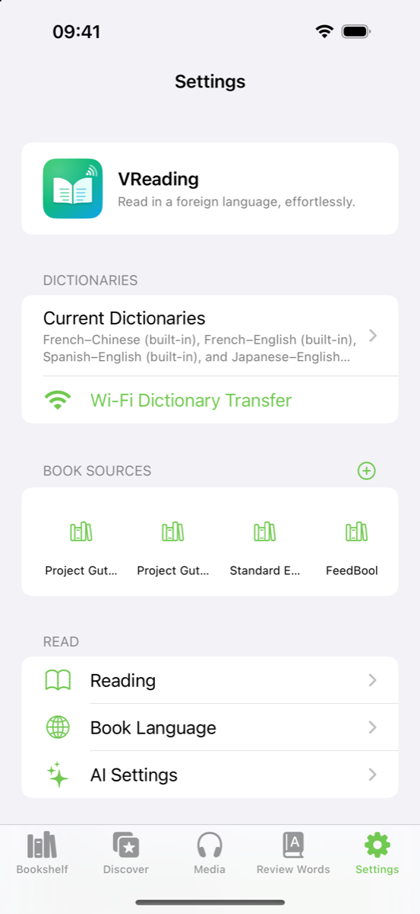

<div align="center">



# VReading

**Read real books in a foreign language. Tap any word to look it up.**

An open-source iOS reader for language learners. It does dictionary lookup, translation, AI explanations, graded vocabulary and spaced repetition, all inside the book you're reading.

[](https://github.com/LucianVane/VReading/actions/workflows/ci.yml)


English · [简体中文](README.zh-CN.md)

</div>

---

## Screenshots

<table>
  <tr>
    <td align="center"><br/><sub><b>Bookshelf</b></sub></td>
    <td align="center"><br/><sub><b>Reader</b>: graded words highlighted</sub></td>
    <td align="center"><br/><sub><b>Tap to look up</b></sub></td>
  </tr>
  <tr>
    <td align="center"><br/><sub><b>Discover</b>: books at your level</sub></td>
    <td align="center"><br/><sub><b>Media</b>: podcasts with subtitles</sub></td>
    <td align="center"><br/><sub><b>Vocabulary book</b></sub></td>
  </tr>
  <tr>
    <td align="center"><br/><sub><b>Review</b>: spaced repetition</sub></td>
    <td align="center"><br/><sub><b>Wi-Fi transfer</b></sub></td>
    <td align="center"><br/><sub><b>Settings</b></sub></td>
  </tr>
</table>

## Features

- **Reader:** EPUB, PDF and TXT. Tap a word to look it up, and its sentence is captured with it. Highlights, notes, bookmarks and full-text search. Fonts, line height and themes with paper textures. Page-turn styles are cover, slide, curl or none. Day/night and an E-ink mode.
- **Dictionaries:** a pure-Swift MDict (`.mdx` / `.mdd`) parser for versions 1.2 and 2.0, including encrypted key blocks. Import your own dictionaries over Wi-Fi or from the Files app, or use web dictionaries.
- **Bundled free dictionaries:** French→Chinese, French→English, Spanish→English and Japanese→English, converted from [FreeDict](https://freedict.org) and JMdict.
- **Graded vocabulary:** words are highlighted by level (CET-4/6, IELTS, TOEFL, CEFR for French and Spanish). Book "dialysis" shows the vocabulary profile of a whole book before you read it.
- **Vocabulary book:** SM-2 spaced-repetition review. Export to an Anki `.apkg`, PDF or TXT.
- **Translation:** DeepL, OpenAI, DeepSeek, Baidu, Youdao, Tencent Cloud, Caiyun, NiuTrans and Azure. Falls back to Apple's on-device Translation framework.
- **AI tutor:** explains words, phrases and sentences, with streaming chat. Works with any OpenAI-compatible chat-completions endpoint, so you can use your own key.
- **Book sources:** OPDS catalogs (Project Gutenberg and Standard Ebooks are preconfigured), WebDAV and web libraries.
- **Graded recommendations:** public-domain books from Project Gutenberg, ranked by CEFR level (A1–C2) using a vocabulary and sentence-length analysis.
- **Podcasts:** listen to language-learning podcasts with synced, tappable subtitles. Subtitles come from `podcast:transcript` when the feed has it, or from on-device speech recognition.
- **Web reading:** read web articles with tap-to-look-up.
- **Wi-Fi transfer:** upload books and dictionaries from a computer's browser.
- **Localized:** the interface is in English by default, with Simplified Chinese included. It follows the system language, and you can switch it in **Settings → App Language** or in iOS Settings → Apps → VReading → Language.

No account and no tracking. All data stays on the device.

## User guide

### 1. Get books onto your shelf

The app comes with a sample book (*The Moon and Sixpence*). To add more, tap **⊕** at the top right of the **Bookshelf**:

- **Import Books:** pick EPUB, PDF or TXT files from the Files app. You can also open a book from another app and choose VReading.
- **Wi-Fi Transfer:** open the address shown on the screen in a browser on your computer (same Wi-Fi network), then drag files onto the page. Keep the app open while uploading.
- **Download free books:** open **Discover** and tap **Download** on any title, or tap the 🏛 icon to browse the OPDS catalogs (Project Gutenberg, Standard Ebooks…).

Long-press a book to pin it, move it to a group, see its Vocabulary Profile, share it or delete it. Tap **Edit** to manage several books at once.

### 2. Read and look up words

- **Turning pages:** tap the left or right side of the page, or swipe. Tap the middle, or swipe up or down, to show the menu.
- **Menu:** the bottom bar has Contents, Notes, Settings (font, size, line height, theme, page-turn style), Brightness, More and Day/Night. The top bar has Bookmark, Search, **AI Mind Map** and **Vocabulary Profile**.
- **Look up a word:** tap it. The panel shows the pronunciation, the word's level tags, the sentence it came from, your dictionaries and **AI Explain**. Tap **Add to Vocabulary** to save the word together with its sentence.
- **Select text:** long-press and drag to **Highlight**, add a **Note**, look the text up, **Translate** it or **Copy** it.
- **Graded highlighting:** words from the levels you chose are colored as you read. Change the levels in *Settings → Reading* (word levels highlighted while reading).
- **Font size:** pinch on the page to resize the text.

### 3. Review your vocabulary

Open **Review Words** to see the words due today, then tap **Start Review**. For each card, choose **Don't Know**, **Not Sure** or **Know It**. The SM-2 algorithm uses your answer to schedule the next review. Tap the share icon at the top right to export your words as an Anki deck (`.apkg`), PDF or TXT.

### 4. Find books and podcasts at your level

- **Discover:** choose a language (English or French) and your CEFR level. Books are ranked by how much of their vocabulary you are likely to know (*coverage*). Tap **Download** to add a book to your shelf.
- **Media:** pick a podcast and an episode. Subtitles scroll in sync with the audio, you can tap any word to look it up, and tap a line to jump to it. Turn on the translate icon to show line-by-line translations. Tap **+** to add any podcast by its RSS URL.

### 5. Set up dictionaries, translation and AI (optional)

| What | Where | Notes |
| --- | --- | --- |
| Local dictionaries | *Settings → Dictionaries* | Import `.mdx` / `.mdd` / `.css` files, set the language and order of each. Free French, Spanish and Japanese dictionaries are built in. |
| Web dictionaries | *Settings → Dictionaries* | Wiktionary, Collins, Longman, Cambridge and more; each appears as a tab in the lookup panel. |
| Translation engines | *Settings → Reading → Translation Engines* | Add your own DeepL, OpenAI, DeepSeek, Azure… key. Without one, Apple's on-device translation is used. |
| AI tutor | *Settings → AI Settings* | Any OpenAI-compatible endpoint: set the host, model and API key, and customize the prompts. |
| Interface language | *Settings → App Language* | English, 简体中文 or follow the system. |

## Install

**Unsigned IPA (sideloading):** download `VReading-vX.Y.Z-unsigned.ipa` from [Releases](https://github.com/LucianVane/VReading/releases/latest), then sign and install it with [AltStore](https://altstore.io), [SideStore](https://sidestore.io) or [Sideloadly](https://sideloadly.io). With a free Apple ID the app must be re-signed every 7 days. Requires iOS 18 or later.

**Build it yourself:** see [Getting started](#getting-started) below.

Maintainers: pushing a tag such as `v1.0.0` runs [`release.yml`](.github/workflows/release.yml), which builds the unsigned IPA and attaches it to a GitHub Release.

## Requirements

- Xcode 26 or later (iOS 26 SDK; the app still deploys to iOS 18)
- Runs on iOS 18.0 or later (iPhone and iPad)
- No third-party dependencies. The project uses only Apple frameworks: SwiftUI, WebKit, PDFKit, Network, Speech, AVFoundation and Translation.

## Getting started

```bash
git clone https://github.com/LucianVane/VReading.git
cd VReading
open VReading.xcodeproj
```

Select the **VReading** scheme and run it on a simulator. The app builds and runs with no configuration.

### Running on a device / personal settings

Personal values live in a git-ignored `Local.xcconfig`:

```bash
cp Local.xcconfig.example Local.xcconfig
```

Then set `DEVELOPMENT_TEAM` and a `PRODUCT_BUNDLE_IDENTIFIER` that you own. `Base.xcconfig` includes this file automatically if it exists.

### API keys

VReading ships **without any API keys**. To use the AI and translation features, enter your own key in the app: **Settings → AI** or **Settings → Translation**.

For personal builds only, you can set `DEEPSEEK_API_KEY` in `Local.xcconfig` to make it the default. Never ship a build with a personal key embedded, because keys in an app binary can be extracted.

## Dictionaries

The repository includes only dictionaries that may be redistributed (see [THIRD_PARTY_NOTICES.md](THIRD_PARTY_NOTICES.md)). There is **no built-in English→Chinese dictionary** in the repo, because the commonly used ones are copyrighted.

You can add one yourself in either of these ways:

- **In the app:** import any `.mdx` / `.mdd` file through Wi-Fi transfer or the Files app.
- **At build time:** put your own `21_en_zh.mdx` (and optionally `21_en_zh.css`) in `VReading/Resources/Data/`. It is detected automatically and is git-ignored.

To convert other FreeDict dictionaries:

```bash
python3 tools/dictd2mdx.py <name>.index <name>.dict.dz out.mdx "Title"
```

## Project structure

```
VReading/
├── App/          App entry point, debug automation
├── Core/         Database (SQLite), models, settings, EPUB & ZIP parsing
├── Reader/       WKWebView reader with CSS-column pagination, PDF reader, mind map
├── Library/      Bookshelf, book detail, vocabulary "dialysis"
├── Dictionary/   MDict parser, lookup UI, translation & AI services, TTS
├── Vocabulary/   Vocabulary book, SM-2 review, Anki/PDF export
├── Store/        OPDS, WebDAV and web book sources
├── Recommend/    Graded reading recommendations
├── Multimedia/   Podcast player and transcription
├── WebRead/      Web article reading
├── Settings/     Settings screens
├── Common/       Wi-Fi transfer server, UI helpers
└── Resources/    Assets, bundled data, reader JavaScript (Web.bundle)
tools/            Python/shell scripts that generate the bundled data
```

The Xcode project uses a **folder-synchronized group**, so any file you add under `VReading/` is picked up automatically.

## Regenerating data

| Data | Command |
| --- | --- |
| French irregular verbs | `python3 tools/gen_fr_irregular.py VReading/Resources/Data/fr_irregular.json` |
| French recommendations | `python3 tools/build_recommendations.py candidates.json FleLex_TT_Beacco.tsv <text-cache> VReading/Resources/Data/recommend_fr.json 18` |
| English recommendations | `tools/build_en_catalog.sh [workdir]` |
| App icon | `swift tools/make_icon.swift` |

## Debug launch arguments

These are available in Debug builds only. See `DebugAutomation` in `App/VReadingApp.swift`.

`-autoOpenBook`, `-autoChapter N`, `-autoNext`, `-autoTapWord`, `-autoMenu`, `-autoTab store|web|media|words|settings`, `-autoOpenSource N`, `-autoAddWords`, `-autoLearn`, `-autoExport`, `-autoWiFi`, `-autoStats`

They are handy for taking screenshots. For example, this opens the sample book and taps a word:

```bash
xcrun simctl launch booted io.github.vreading.app -autoOpenBook -autoChapter 3 -autoTapWord
```

## Roadmap

- [x] English UI with Simplified Chinese localization (String Catalog)
- [ ] More UI languages (Japanese, Spanish, French, …)
- [ ] Unit tests for the MDict parser, EPUB parser and SM-2 scheduler
- [ ] iCloud sync for the vocabulary book and highlights
- [ ] More bundled open dictionaries

Contributions are welcome, especially **new UI translations**. See [Translating](#translating).

## Translating

All UI strings live in two String Catalogs:

- `VReading/Resources/Localizable.xcstrings`: in-app text, with English as the source language
- `VReading/Resources/InfoPlist.xcstrings`: system permission prompts

To add a language, open the project in Xcode, select a catalog, click **+** and choose the language, then fill in the translations. Also add the language to the in-app picker in `Core/AppLanguage.swift`. The Wi-Fi transfer web page uses its own strings in `Resources/Web.bundle/wifi/scripts/lang.*.js`.

## Contributing

See [CONTRIBUTING.md](CONTRIBUTING.md). By participating you agree to the [Code of Conduct](CODE_OF_CONDUCT.md). To report a vulnerability, see [SECURITY.md](SECURITY.md).

## License

The source code is released under the [MIT License](LICENSE).

Bundled data files (dictionaries, word lists, sample book, JavaScript libraries) keep their own licenses. Some of them, such as GPL dictionaries and CC BY-NC-SA level data, are **more restrictive than MIT**. Read [THIRD_PARTY_NOTICES.md](THIRD_PARTY_NOTICES.md) before you redistribute the app, especially if you distribute it commercially.
