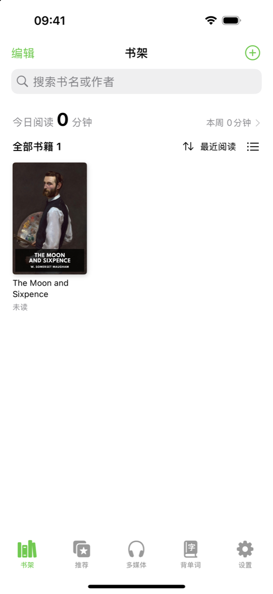
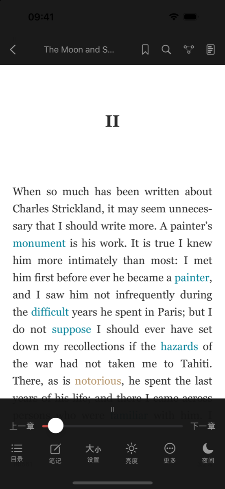
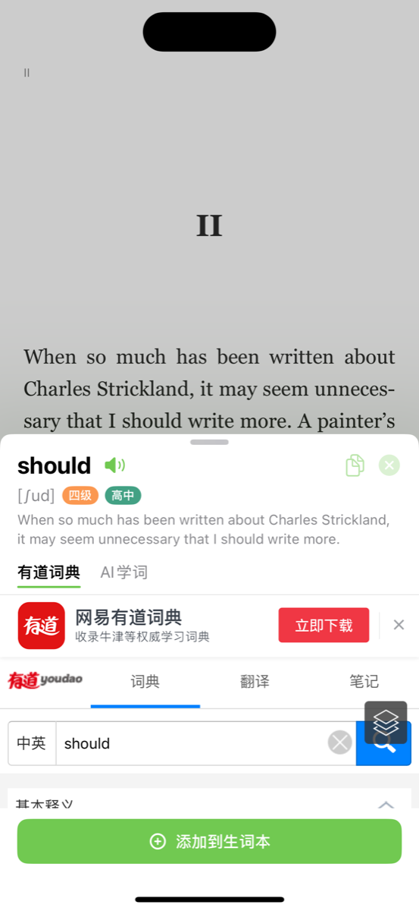
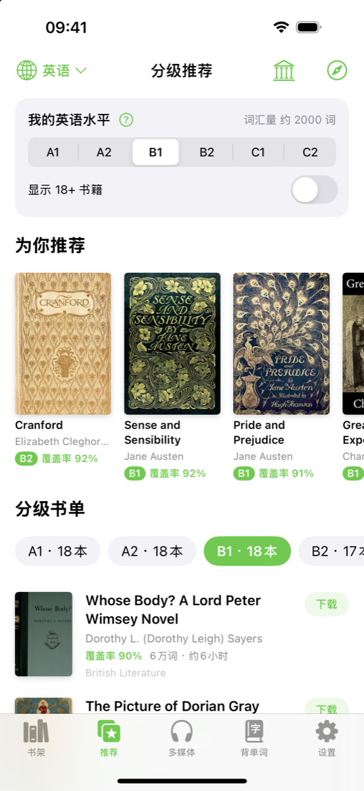
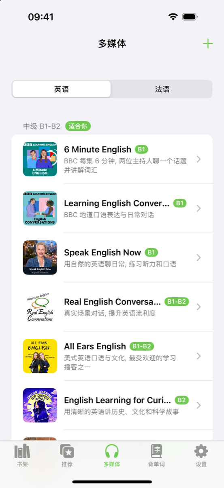
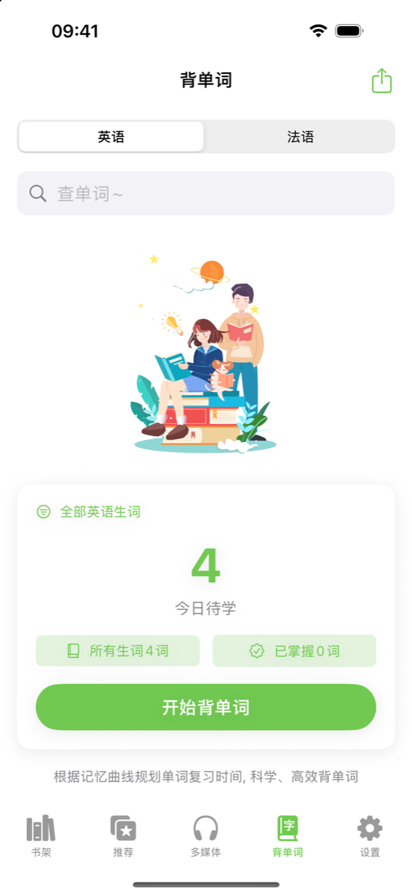
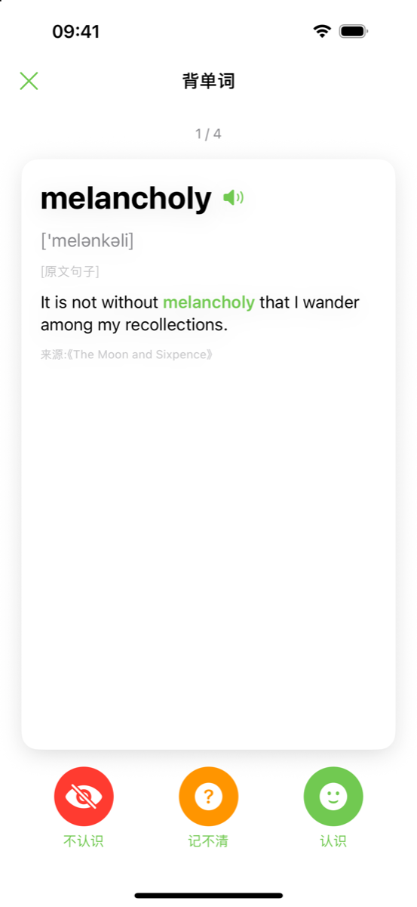
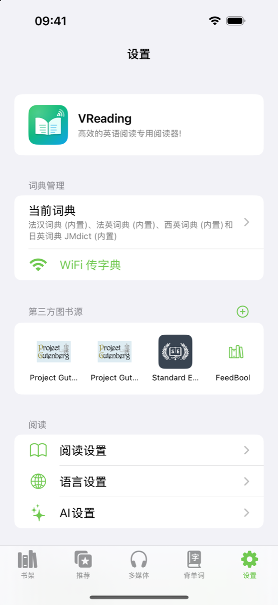

<div align="center">


# VReading

**用外语读真正的书，点一下就能查词。**

一款面向外语学习者的开源 iOS 阅读器。在你正在读的书里就能查词、翻译、问 AI、按等级标注词汇、用间隔重复背单词。

[English](README.md) · 简体中文

</div>

---

## 截图

<table>
  <tr>
    <td align="center"><br/><sub><b>书架</b></sub></td>
    <td align="center"><br/><sub><b>阅读器</b>：分级词汇高亮</sub></td>
    <td align="center"><br/><sub><b>点击查词</b></sub></td>
  </tr>
  <tr>
    <td align="center"><br/><sub><b>推荐</b>：适合你水平的书</sub></td>
    <td align="center"><br/><sub><b>多媒体</b>：带字幕的播客</sub></td>
    <td align="center"><br/><sub><b>生词本</b></sub></td>
  </tr>
  <tr>
    <td align="center"><br/><sub><b>背单词</b>：间隔重复</sub></td>
    <td align="center"><br/><sub><b>WiFi 传书</b></sub></td>
    <td align="center"><br/><sub><b>设置</b></sub></td>
  </tr>
</table>

## 功能

- **阅读器**：支持 EPUB / PDF / TXT。点击查词，并自动取出所在句子；划线、笔记、书签、全文搜索；可调字体、行距、主题和纸张纹理；翻页方式有覆盖、滑动、仿真、无动画；日间/夜间和墨水屏模式。
- **词典**：纯 Swift 实现的 MDict（mdx / mdd）解析器，支持 1.2 / 2.0 版本和加密的 key 块；可以通过 Wi-Fi 或"文件"导入自己的词典，也可以用网页词典。
- **内置免费词典**：法汉、法英、西英、日英，由 [FreeDict](https://freedict.org) 和 JMdict 转换而来。
- **分级词汇**：按 CET-4/6、雅思、托福，以及法语、西班牙语 CEFR 等级高亮单词；"词汇透析"可以在阅读前看到整本书的词汇构成。
- **生词本**：SM-2 间隔重复复习，可导出 Anki apkg / PDF / TXT。
- **翻译**：支持 DeepL、OpenAI、DeepSeek、百度、有道、腾讯云、彩云、小牛、Azure；没有配置时使用系统自带的 Translation 框架。
- **AI 讲解**：讲解单词、短语、句子，支持流式对话。兼容任何 OpenAI chat completions 接口，用你自己的 Key。
- **书源**：OPDS（已预置 Project Gutenberg、Standard Ebooks）、WebDAV、网页书库。
- **分级推荐**：从 Project Gutenberg 公版书中，按词汇难度和句长分析出 CEFR A1–C2 等级。
- **播客**：收听语言学习播客，字幕与音频同步，可以点击查词。有 `podcast:transcript` 时直接使用，没有时用设备端语音识别生成。
- **网页阅读**：阅读网页文章，同样可以点击查词。
- **Wi-Fi 传书**：在电脑浏览器里上传书籍和词典。
- **多语言界面**：默认英文，内置简体中文。界面语言跟随系统，也可以在 **设置 → 界面语言**，或 iOS 设置 → App → VReading → 语言 中切换。

不需要注册账号，没有任何追踪，所有数据都留在本机。

## 使用说明

### 1. 把书放进书架

App 自带一本示例书（《月亮与六便士》英文原版）。要添加更多书，点 **书架** 右上角的 **⊕**：

- **导入本地书籍**：从"文件"中选择 EPUB / PDF / TXT。也可以在其他 App 里打开书籍，选择用 VReading 打开。
- **WiFi 传书**：电脑和手机连同一个 Wi-Fi，在电脑浏览器中输入屏幕上显示的地址，把文件拖到网页上即可。上传时不要关闭页面或锁屏。
- **下载免费书**：在 **推荐** 页点任意一本书的 **下载**，或点右上角的 🏛 图标浏览 OPDS 书库（Project Gutenberg、Standard Ebooks 等）。

长按书籍可以置顶、移动到分组、查看词汇透析、分享或删除。点 **编辑** 可以批量管理。

### 2. 阅读和查词

- **翻页**：点击页面左侧或右侧，或者左右滑动。点击页面中间，或上下滑动，可以呼出菜单。
- **菜单**：底部是 目录、笔记、设置（字体、字号、行高、主题、翻页方式）、亮度、更多、日间/夜间；顶部是 书签、搜索、**AI 思维导图** 和 **词汇透析**。
- **查词**：点击单词即可。查词面板会显示发音、单词等级、所在原句、你的词典和 **AI 学词**。点 **添加到生词本** 会把单词和原句一起保存。
- **选中文字**：长按并拖动，可以 **划线**、写 **笔记**、查词典、**翻译** 或 **拷贝**。
- **分级高亮**：阅读时，你选择的等级（四六级、考研、雅思等）的单词会自动着色。可在 *设置 → 阅读设置* 中修改。
- **字号**：在页面上双指缩放即可调整字号。

### 3. 背单词

打开 **背单词** 页，可以看到今天需要复习的单词，点 **开始背单词**。每张卡片选择 **不认识**、**记不清** 或 **认识**，SM-2 算法会据此安排下次复习时间。点右上角的分享图标，可以把生词导出为 Anki 卡组（`.apkg`）、PDF 或 TXT。

### 4. 找适合自己水平的书和播客

- **推荐**：选择语言（英语 / 法语）和你的 CEFR 水平。书籍按你大概率认识的词汇比例（*覆盖率*）排序，点 **下载** 即可加入书架。
- **多媒体**：选择一个播客节目和一集。字幕随音频同步滚动，可以点击任意单词查词，点击句子跳转播放。打开翻译图标可以显示逐句翻译。点 **+** 可以通过 RSS 地址添加任意播客。

### 5. 配置词典、翻译和 AI（可选）

| 功能 | 位置 | 说明 |
| --- | --- | --- |
| 本地词典 | *设置 → 词典管理* | 导入 `.mdx` / `.mdd` / `.css`，设置每部词典的语言和顺序。已内置法语、西班牙语、日语免费词典。 |
| 网页词典 | *设置 → 词典管理* | 有道、Wiktionary、柯林斯、朗文、剑桥等，每个会作为查词面板中的一个标签页。 |
| 翻译引擎 | *设置 → 阅读设置 → 翻译引擎配置* | 填写你自己的 DeepL、OpenAI、DeepSeek、百度、Azure 等 Key。未配置时使用系统自带的离线翻译。 |
| AI 讲解 | *设置 → AI设置* | 支持任何 OpenAI 兼容接口：填写域名、模型和 API Key，还可以自定义提示词。 |
| 界面语言 | *设置 → 界面语言* | English、简体中文，或跟随系统。 |

## 安装

**未签名 IPA（自签安装）：** 从 [Releases](https://github.com/LucianVane/VReading/releases/latest) 下载 `VReading-vX.Y.Z-unsigned.ipa`，再用 [AltStore](https://altstore.io)、[SideStore](https://sidestore.io) 或 [Sideloadly](https://sideloadly.io) 签名安装。使用免费 Apple ID 签名时，每 7 天需要重新签名一次。需要 iOS 18 或更高版本。

**自己编译：** 见下方「快速开始」。

维护者：推送 `v1.0.0` 这样的版本 tag 会触发 [`release.yml`](.github/workflows/release.yml)，自动编译未签名 IPA 并发布到 GitHub Release。

## 环境要求

- Xcode 26 或更高版本（需要 iOS 26 SDK；App 最低支持 iOS 18）
- 运行在 iOS 18.0 及以上的 iPhone / iPad
- 不依赖任何第三方库

## 快速开始

```bash
git clone https://github.com/LucianVane/VReading.git
cd VReading
open VReading.xcodeproj
```

选择 **VReading** scheme，在模拟器上运行即可，不需要做任何配置。

### 真机运行 / 个人配置

```bash
cp Local.xcconfig.example Local.xcconfig
```

在 `Local.xcconfig` 中填写你的 `DEVELOPMENT_TEAM` 和 `PRODUCT_BUNDLE_IDENTIFIER`。这个文件已被 git 忽略，`Base.xcconfig` 会在它存在时自动引用。

### API Key

仓库里**不包含任何 API Key**。要使用 AI 和翻译功能，请在 App 的 **设置 → AI设置 / 翻译设置** 中填写你自己的 Key。

如果只是自用，也可以在 `Local.xcconfig` 中设置 `DEEPSEEK_API_KEY` 作为默认值。不要发布内嵌个人 Key 的版本，因为打包进 App 的 Key 可以被提取出来。

## 词典

仓库里只包含允许再分发的词典（见 [THIRD_PARTY_NOTICES.md](THIRD_PARTY_NOTICES.md)）。常用的英汉词典有版权，所以**仓库中没有内置英汉词典**。

你可以用以下任一方式添加：

- **在 App 中**：通过 Wi-Fi 传书或"文件"导入任意 `.mdx` / `.mdd`。
- **构建时**：把你自己的 `21_en_zh.mdx`（可选 `21_en_zh.css`）放到 `VReading/Resources/Data/`。App 会自动识别它，这个文件也已被 git 忽略。

## 参与贡献

请阅读 [CONTRIBUTING.md](CONTRIBUTING.md)。目前最需要的是**更多界面语言的翻译**。所有界面文本都在 `VReading/Resources/Localizable.xcstrings`（String Catalog）中，在 Xcode 里添加语言后填写翻译即可，然后在 `Core/AppLanguage.swift` 中把新语言加入 App 内的语言选项。

## 许可证

源代码采用 [MIT 许可证](LICENSE)。

内置的数据文件（词典、词表、示例书籍、JS 库）沿用各自的许可证，其中一些比 MIT 更严格，例如 GPL 词典和 CC BY-NC-SA 的分级数据。再分发前，尤其是商业分发前，请先阅读 [THIRD_PARTY_NOTICES.md](THIRD_PARTY_NOTICES.md)。
